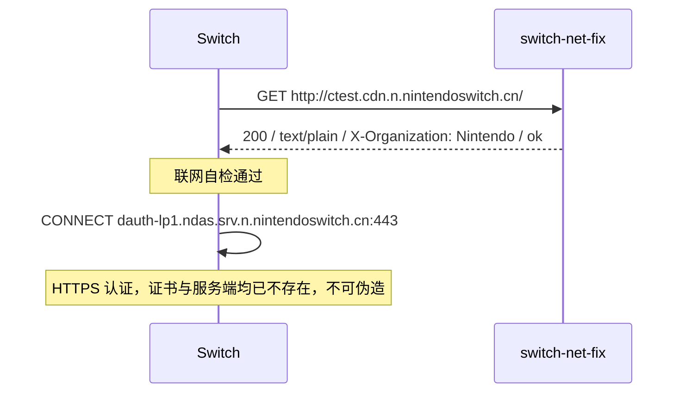

# switch-net-fix

[](https://github.com/chengjungao/switch-net-fix/actions/workflows/ci.yml)
[](https://www.python.org/)
[](LICENSE)

让已停止运营的国行 Nintendo Switch 重新通过联网自检。

腾讯于 **2026-05-15 22:00** 关闭国行 Switch 全部网络服务，并把 `*.nintendoswitch.cn`
整段域名从 DNS 撤除。主机的联网判定写死在这个域名上，于是永远显示「互联网：未连接」，
一点联网相关操作就弹「需要连接互联网」。

本项目在局域网内伪造连接自检的响应，让主机恢复正常判断。

```
HTTP/1.1 200 OK
Content-Type: text/plain
X-Organization: Nintendo
Content-Length: 2

ok
```

纯 Python 标准库实现，无第三方依赖。协议细节见 [docs/PROTOCOL.md](docs/PROTOCOL.md)。

## 能做到什么

| | |
|---|---|
| ✅ 消除「互联网：未连接」红叉 | 三格自检全部通过 |
| ✅ 消除「需要连接互联网」类拦截弹窗 | 部分游戏的前置联网检查会放行 |
| ✅ 记录主机在找哪些服务 | 便于确认边界，也便于将来复用 |
| ❌ 恢复 eShop | 服务端已下线，无内容可获取 |
| ❌ 下载游戏更新 / 补丁 | 更新通道同样绑定在已注销的域名上 |
| ❌ 在线联机、排行榜 | 服务器不存在 |
| ❌ 云存档 | 国行从未提供此功能 |

自检通过后，主机会紧接着请求 `dauth-lp1.ndas.srv.n.nintendoswitch.cn:443` 做设备认证。
这一步是 HTTPS，腾讯签发的证书与服务端都已消失，**原理上无法伪造**。



换句话说：**它让主机不再误判自己断网，但不会复活已经死掉的服务。**

## 快速开始

### Windows

```bat
scripts\start.bat
```

窗口会打印本机局域网 IP 和端口，例如 `192.168.101.91:8080`。

Switch 端设置（只需一次）：

```
设置 → 互联网 → 互联网设置 → 选中你的 Wi-Fi → 更改设置
     → 代理服务器设置 → 使用
     → 服务器 192.168.101.91    端口 8080
```

保存后回主界面，进 **设置 → 互联网 → 连接测试**，三格应全部通过。

开机自启：双击 `scripts\install_autostart.bat`。
撤销：`Win+R` 输入 `shell:startup`，删掉 `SwitchNetFix.lnk`。

### Linux / 任意常开设备（推荐 NAS、树莓派、软路由）

```bash
python3 -m switch_net_fix --port 80
```

配合路由器上的一条静态 DNS 记录把 `ctest.cdn.n.nintendoswitch.cn` 指向这台设备，
Switch 端就**什么都不用配**（代理设为"不使用"，DNS 保持自动）。

systemd 部署：

```bash
sudo mkdir -p /opt/switch-net-fix
sudo cp -r switch_net_fix /opt/switch-net-fix/
sudo cp scripts/switch-net-fix.service /etc/systemd/system/
sudo systemctl enable --now switch-net-fix
```

### OpenWrt 路由器

```sh
opkg update && opkg install python3-light
sh scripts/install-openwrt.sh
```

脚本会拷贝代码、注册 procd 服务、把 `ctest` 域名指向路由器、并把 LuCI 管理页面从 80 挪到 8080。
Switch 端保持默认网络设置即可。

## 参数

| 参数 | 说明 |
|---|---|
| `--port N` | 监听端口，默认 `8080` |
| `--bind ADDR` | 监听地址，默认 `0.0.0.0` |
| `--only-ctest` | 只伪造连接自检，其他国服域名照常转发 |
| `--quiet` | 不打印单个请求，仍写日志 |
| `--log-dir DIR` | 日志目录，默认 `logs` |
| `--no-log` | 不写日志文件 |
| `--version` | 打印版本 |

也可以装成命令：

```bash
pip install .
switch-net-fix --port 8080
```

## 排错

**端口被占用** → `--port 8081`，Switch 上的代理端口同步改。

**Switch 连不上代理 / 超时**

1. 确认 PC 与 Switch 在同一网段
2. Windows 防火墙首次启动时需选「允许访问」，或手动放行：

```powershell
New-NetFirewallRule -DisplayName "Switch Net Fix" -Direction Inbound -Protocol TCP -LocalPort 8080 -Action Allow
```

**自检仍然红叉，日志每 3 秒刷一条** → 响应头不完整。协议要求四个要素缺一不可，见
[docs/PROTOCOL.md](docs/PROTOCOL.md#4-连接自检协议)。

**日志出现 `[国服 HTTPS，无法伪造]`** → 这是预期行为，不是故障。该域名需要腾讯签发的证书
和在线服务端，任何本地手段都无法伪造。

## 开发

```bash
python -m unittest discover -s tests -t . -v
```

38 个测试用例，覆盖响应构造、域名匹配、报文解析、端到端 socket 行为和脚本编码约定。

### 脚本编码约定（踩过坑，务必遵守）

`scripts/*.bat` **只写 ASCII、只用 CRLF，且禁止出现 `chcp`**。

原因：`cmd.exe` 按当前控制台代码页（中文 Windows 为 936/GBK）解析 bat，并且
是**按字节偏移逐行读**的。若文件里出现 UTF-8 中文，或在中途执行 `chcp 65001`，
读指针就会错位，`rem` / `set` 等命令前缀被吞掉，中文残片被当作命令执行，典型报错：

```
'鎵句竴涓彲鐢ㄧ殑' 不是内部或外部命令，也不是可运行的程序或批处理文件。
```

中文提示一律交给 Python 输出——Python 在 Windows 控制台通过 `WriteConsoleW`
以 UTF-16 写入，不依赖控制台代码页，天然正常。

```
switch-net-fix/
├─ switch_net_fix/
│  ├─ responder.py    自检响应的构造与域名判定
│  ├─ httpio.py       最小化 HTTP 解析与隧道转发
│  ├─ server.py       并发服务主体
│  ├─ logsetup.py     控制台 + 文件日志
│  └─ cli.py          命令行入口
├─ tests/             单元与集成测试
├─ scripts/           启动脚本、systemd unit、OpenWrt 安装脚本
└─ docs/PROTOCOL.md   协议分析、官方口径核对与误传辟谣
```

协议文档里有两类内容值得单独说明：

- **§3–§8 实测部分**：抓包得到的请求列表、自检响应的四要素、以及「把 `.cn` 真的
  映射到全球节点会发生什么」的反证实验（主机收到证书后 362ms 发出 24 字节 Alert 断开）。
- **§9 官方口径与误传核对**：腾讯公告原文、19.0.1 → 23.0.1 版本谱系、
  「有博主把国行机升到 23」的真实做法与分辨判据。第三方说法一律标来源等级，
  未经证实的内容单独隔离，不与实测结论混写。

## 免责声明

本项目仅用于让用户不再被已停止运营的服务反复打扰，不绕过任何付费、版权或
技术保护措施，不提供、不传播任何游戏内容或系统固件。

不修改主机固件、不做破解、不触碰任何账号体系。所有操作只发生在本机局域网的
明文 HTTP 层。使用风险自负。

## License

[MIT](LICENSE)
